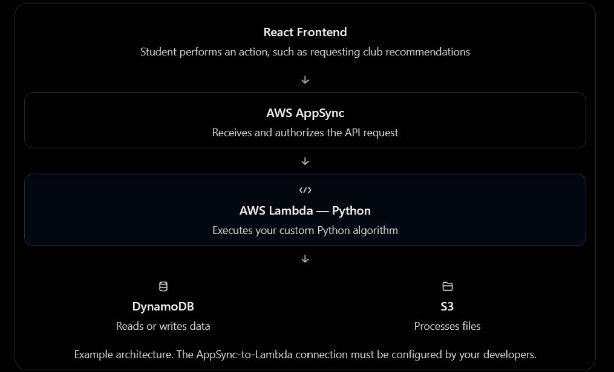
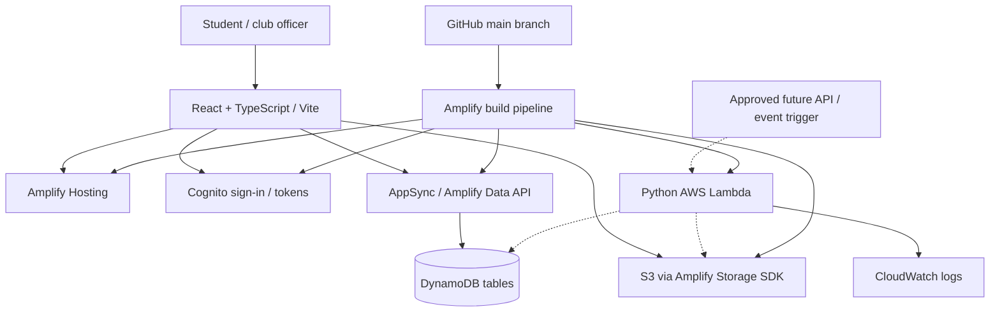

# SIBC Amazon Club Platform — AWS Setup & Developer Handoff

**Project:** 2026 Fall Amazon / SIBC Club Platform  
**AWS infrastructure:** AWS Amplify Gen 2 (serverless)  
**AWS Region:** `us-east-2` — US East (Ohio)  
**Amplify app:** `sibc-amazon-club-platform` (`d1hufekmax824i`)  
**Deployment branch:** `main`  
**Environment:** Shared development / MVP — **not production-ready**  
**Last reviewed:** October 23, 2026

> **Start here:** The infrastructure is provisioned and the Python Lambda template has been tested. Application screens, API integrations, club-specific authorization, and production security are **the development team's work**, not completed functionality. Do not treat this environment as approved for confidential student or club financial information.


## AWS Architecture

The SIBC Amazon Club Platform uses a serverless
architecture built on AWS Amplify Gen 2.



*Example backend workflow: React → AppSync → Python Lambda
→ DynamoDB / S3. The AppSync-to-Lambda integration must
be configured when implementing the relevant feature.*


## 1. Quick start (application developers)

1. Get access to the [GitHub repository](https://github.com/2026-Fall-Amazon/Code) and follow its [README](https://github.com/2026-Fall-Amazon/Code#readme) to configure GitHub SSH and the weekly branch workflow.
2. Install a compatible **Node.js LTS**, npm, Git, and VS Code. Clone the repo if you have not already:

   ```bash
   git clone git@github.com:2026-Fall-Amazon/Code.git
   cd Code
   ```

3. Install the **separate** root/backend and frontend dependencies:

   ```bash
   npm ci
   npm --prefix frontend ci
   ```

4. Ask a project lead for the shared `main` environment's `frontend/amplify_outputs.json`, **or**, if you have AWS CLI permissions and an authenticated AWS profile, generate it at the repository root:

   ```bash
   npx ampx generate outputs --app-id d1hufekmax824i --branch main --out-dir frontend
   ```

5. Start the local React app:

   ```bash
   npm --prefix frontend run dev
   ```

6. Use a **test Cognito user** to sign in. Never use or share an AWS administrator account for application login.

> `frontend/src/main.tsx` loads `../amplify_outputs.json`, which resolves to `frontend/amplify_outputs.json`. The generated file is environment-specific and gitignored. It describes service endpoints and identifiers; it is **not** an AWS access key or secret. Share it only through the agreed team channel, not as an unreviewed Git commit. If you need a refreshed file after backend changes, regenerate/download it.

## 2. Service directory

These links and service descriptions expand the team's existing *Organization.pdf* inventory.

| Service | Purpose | Console link |
| --- | --- | --- |
| **AWS Console** | Account/Region entry point | [Console Home (Ohio)](https://us-east-2.console.aws.amazon.com/console/home?region=us-east-2) |
| **Amplify Hosting / Gen 2** | React hosting, GitHub CI/CD, backend deployment | [Amplify `main` deployments](https://us-east-2.console.aws.amazon.com/amplify/apps/d1hufekmax824i/branches/main/deployments?region=us-east-2) |
| **Amazon Cognito** | Student sign-up, sign-in and identity tokens | [Cognito user pools](https://us-east-2.console.aws.amazon.com/cognito/v2/idp/user-pools?region=us-east-2) |
| **AWS AppSync** | Managed API generated by Amplify Data | [AppSync APIs](https://us-east-2.console.aws.amazon.com/appsync/home?region=us-east-2#/apis) |
| **Amazon DynamoDB** | Structured club, member, event and announcement records | [DynamoDB tables](https://us-east-2.console.aws.amazon.com/dynamodbv2/home?region=us-east-2#tables) |
| **Amazon S3** | Club documents, images, event flyers | [S3 buckets (Ohio)](https://s3.console.aws.amazon.com/s3/buckets?region=us-east-2) |
| **AWS Lambda** | Custom Python business logic | [Lambda functions (Ohio)](https://us-east-2.console.aws.amazon.com/lambda/home?region=us-east-2#/functions) |
| **Amazon CloudWatch** | Function logs, metrics and troubleshooting | [CloudWatch log groups](https://us-east-2.console.aws.amazon.com/cloudwatch/home?region=us-east-2#logsV2:log-groups) |
| **AWS IAM** | AWS console permissions for project leads | [IAM console](https://console.aws.amazon.com/iam/home) |
| **Billing / Budgets** | Free-plan credits, account expiry and alerts | [Billing and Cost Management](https://console.aws.amazon.com/costmanagement/home) |

**Hosted frontend:** https://main.d1hufekmax824i.amplifyapp.com  
**Repository:** https://github.com/2026-Fall-Amazon/Code

**Do not confuse:** AWS **IAM** accounts control who can administer cloud resources; **Cognito** users log in to the club application. Access to one does not imply access to the other.

## 3. System architecture



- Solid arrows describe **existing** platform responsibilities; dotted arrows are **future integrations**, not implemented access paths.
- Standard data operations use **Amplify Data / AppSync → DynamoDB**; they do not require Lambda or API Gateway.
- The Python Lambda template has been deployed and manually tested, but **does not yet have an application-facing API, DynamoDB permissions, S3 permissions, or event trigger**.
- The application design includes a file workflow, but individual upload/download pages and metadata records still need implementation.

## 4. Repository layout and sources of truth

```text
Code/
├── amplify/
│   ├── auth/resource.ts                  # Cognito sign-in and groups
│   ├── data/resource.ts                  # AppSync / DynamoDB models and rules
│   ├── storage/resource.ts               # S3 path permissions
│   ├── functions/python-template/
│   │   ├── handler.py                    # Minimal tested Python handler
│   │   └── resource.ts                   # Lambda CDK definition
│   ├── backend.ts                        # Registers backend resources
│   └── package.json                      # ES module configuration
├── frontend/
│   ├── src/main.tsx                      # Amplify.configure + Authenticator
│   ├── src/                              # React application code
│   ├── package.json
│   ├── package-lock.json
│   └── amplify_outputs.json             # Local, generated, gitignored
├── amplify.yml                          # Full-stack CI/CD build specification
├── package.json                         # Root/backend dependencies
├── package-lock.json                    # Locked root dependencies
├── .gitignore
└── README.md                            # Existing Git/SSH/branch instructions
```

**Infrastructure as code:** `amplify/backend.ts` declares the resources that are deployed. Each `resource.ts` defines configuration, models or permissions. The `main` branch in GitHub is the source of truth. **Do not manually create replacement Cognito pools, DynamoDB tables, or S3 buckets**, or modify Amplify-managed resources directly in the AWS Console unless the leads have approved an exceptional change.

**Dependency policy:** Commit both `package.json` and `package-lock.json` when dependencies change, then run `npm ci` locally. Root and `frontend/` are separate npm projects.

## 5. Identity and authorization

### AWS administration (IAM)

- Two project leads have separate IAM accounts with elevated access to this **AWS account**. Enable **MFA** for both and never share credentials.
- Ordinary frontend/application contributors should work through GitHub and Cognito test accounts; they generally **do not need IAM console administrator access**.
- `AmplifyBackendDeploymentRole` is for the CI/CD service, not for application users. Do not change its policies casually.
- Administrative AWS permissions span the account. Project leads must approve infrastructure changes, IAM changes, billing/plan changes, and new resources.

### Application authentication (Cognito)

- Email-based Cognito authentication is enabled through `amplify/auth/resource.ts`.
- React initializes Amplify from `amplify_outputs.json` and wraps the app in `<Authenticator>`.
- Application authorization currently uses a combination of **owner** rules, signed-in-user **read** permissions, and references to the `ADMINS` group.
- **Important open issue:** As reviewed on October 23, `amplify/auth/resource.ts` defines email login but **does not declare `groups: ['ADMINS']`**, even though DynamoDB and S3 definitions rely on that group. The project leads should add and deploy the group, assign only trusted test administrators to it, then sign out/in and verify access. Do not assume administrator-only CRUD or S3 access works just because login succeeds.
- The `ADMINS` Cognito group is **global to this application**, not a club-specific officer role. Club-specific permissions have **not** been implemented.

## 6. Data API and DynamoDB

**Definition:** `amplify/data/resource.ts`  
**Authorization mode:** Cognito User Pool (`userPool`)

| Model | Purpose | Current general authorization intent |
| --- | --- | --- |
| `UserProfile` | Student display name, major, graduation year, interests | Owner access |
| `Club` | Club name, category, description, website, meeting location | Authenticated read; `ADMINS` write/manage |
| `Membership` | Links a user to a club | Owner create/read/delete; `ADMINS` read/delete |
| `Event` | Club event name, times, location and capacity | Authenticated read; `ADMINS` write/manage |
| `RSVP` | Links a user to an event | Owner create/read/delete; `ADMINS` read/delete |
| `Announcement` | Club messages and publication time | Authenticated read; `ADMINS` write/manage |

- The ID fields (`clubId`, `eventId`) are references, **not enforced relational foreign keys**.
- Secondary indexes exist for club-based and event-based queries.
- The current schema does **not** enforce unique club memberships/RSVPs, officer-only writes per club, event capacity, or verification that referenced records exist. These rules require backend work before use with real students.
- Only make schema changes through reviewed pull requests. Destructive changes can affect existing records; agree on a backup/export and migration plan before deployment.
- The frontend team can use typed `generateClient<Schema>()` from `aws-amplify/data`; they should not embed AWS administrator credentials or access tables directly from the browser.

## 7. S3 storage

**Definition:** `amplify/storage/resource.ts`  
**Amplify storage resource name:** `sibcClubFiles`

| Object key prefix | Intended access |
| --- | --- |
| `club-assets/*` | Authenticated users read; `ADMINS` read/write/delete |
| `admin-documents/*` | `ADMINS` read/write/delete only |

- S3 stores **file bytes**. DynamoDB can store file metadata (club ID, object key, uploader, document type, timestamps) when the development team implements this feature.
- S3 access is currently based on broad path prefixes and Cognito groups. **Club-by-club officer permissions and document classification are not complete.**
- Do not store confidential budgets, protected student records, credentials, or other sensitive files in the MVP until permissions, access testing, retention and deletion policies have been reviewed.
- Keep default **Block Public Access** in place; do not make the bucket public for convenience.

## 8. Lambda / Python template

**Source:** `amplify/functions/python-template/`  
**Runtime:** Python 3.13  
**Current function:** `PythonTemplate` (AWS adds generated prefixes/suffixes)  
**Memory:** 128 MB; **timeout:** 5 seconds; **log retention:** one week

The sample `handler.py` returns HTTP-like status `200` and a JSON message: `SIBC Python Lambda is working`. It has been deployed and tested from the Lambda Console with event `{}`.

**For future Python feature owners:**

1. Create a new function directory (or deliberately extend the existing template) and write the Python handler.
2. Define and register its infrastructure through Amplify/CDK in a pull request.
3. Request the **minimum** required permissions to specific DynamoDB tables, S3 prefixes or other resources. The existing template does not have those permissions.
4. Add an authenticated AppSync custom query/mutation or another explicit trigger **only when the feature requires it**. Do not expose an unauthenticated Function URL or API Gateway endpoint by default.
5. Set a sensible timeout, memory limit and CloudWatch log retention; test in the shared environment after the lead approves deployment.

**No separate EC2 instance, always-on Python server, or standalone API Gateway is required for the current MVP.**

## 9. GitHub and Amplify deployment workflow

The repository's `README.md` documents SSH setup, pull requests, and its required **`week_last_first`** naming convention, where `00` represents the first week. Follow that convention for new team branches. Do not work directly on `main`.

Typical commands from the repository root:

```bash
git switch main
git pull --rebase origin main
git switch -c 00_Last_First
# Make and test changes
git status
git add <specific-files>
git commit -m "Describe the change"
git push -u origin 00_Last_First
```

Open a GitHub pull request into `main`, request review, and **squash and merge** when approved. Infrastructure modifications under `amplify/`, `amplify.yml`, `package*.json` or access-control policy files require **review by a project lead**.

### What happens after merge

The repository-root `amplify.yml` performs:

1. `npm ci` in the repository root.
2. `npx ampx pipeline-deploy --branch $AWS_BRANCH --app-id $AWS_APP_ID` to deploy the Gen 2 backend.
3. `npm --prefix frontend ci` for frontend dependencies.
4. Copies generated `amplify_outputs.json` into `frontend/`.
5. `npm --prefix frontend run build`; serves `frontend/dist` via Amplify Hosting.

**Watch deployments:** [Amplify — `main`](https://us-east-2.console.aws.amazon.com/amplify/apps/d1hufekmax824i/branches/main/deployments?region=us-east-2).

For the current Free plan, **deploy only `main`**. Do not enable automatic preview branches or individual Amplify sandboxes without approval: those can create extra chargeable infrastructure and separate databases.

## 10. Local checks before opening a pull request

From the repo root:

```bash
npm ci
npm --prefix frontend ci
npx tsc --noEmit --project amplify/tsconfig.json
npm --prefix frontend run build
```

- A local frontend build requires a valid `frontend/amplify_outputs.json` (see Quick start).
- `npm ci` may warn about transitive dependencies. A warning alone is not an error; check the command's exit status.
- If npm reports a lockfile mismatch, check that `package.json` and `package-lock.json` are in sync. You may try `npm install --package-lock-only` followed by `npm ci`, and review the resulting diff before committing.
- Run `npm audit` separately and triage findings; do **not** run `npm audit fix --force` blindly. The project has previously shown significant transitive dependency warnings.
- A successful TypeScript/Vite build does **not** guarantee that CloudFormation deployments, IAM permissions or real-user authorization are correct.

## 11. Monitoring, cost controls and backups

- **CloudWatch:** Existing Amplify-created Lambda log groups are visible in `us-east-2`; retain application logs for approximately **7 days** rather than indefinitely. New Lambda functions may create new log groups. Avoid optional high-volume logs, alarms, dashboards and insights queries until needed.
- **Budget:** A low-cost monthly alert has been configured; it is an **alert, not a spending cap**. Project leads should check credits, usage and account plan regularly.
- **AWS Free plan:** This account was verified as Free plan. AWS says it expires on the **earlier** of six months after account creation or exhaustion of credits. The account can close and access to data can be lost; **record the actual expiration date in the team tracker and export any data that must be retained before expiry**.
- **Do not upgrade to Paid** or create/join AWS Organizations, Control Tower or other account-level services without explicit project-lead agreement; these actions can change Free plan eligibility.
- **No automatic durable backup is documented.** DynamoDB/S3 backup, restore and export procedures should be agreed on before using real data. Do not switch on paid backup features without checking expected credit consumption.

## 12. Troubleshooting

| Symptom | Check / next step |
| --- | --- |
| `Cannot find module '../amplify_outputs.json'` | Generate or securely obtain the **main** environment's outputs file in `frontend/`; do not invent config values. |
| `npm ci` fails with `Missing: @opentelemetry/core...` | Inspect root package/lock consistency; `npm install --package-lock-only` may repair it, followed by `npm ci`. Check resulting changes. |
| Amplify backend build fails on `ssm:GetParameter` | Check the attached `AmplifyBackendDeploymentRole` and its approved backend deployment policy. Do not grant broad ad-hoc permissions blindly. |
| `BootstrapNotDetectedError` / missing `/cdk-bootstrap/.../version` | Check for a completed **CDKToolkit** bootstrap stack in `us-east-2` before asking a lead to re-bootstrap. |
| Amplify deployment canceled | Inspect the **Build** logs for the first fatal `[ERROR]`; deployment cancellation is often downstream of a build failure. |
| Cognito sign-in works but admin write fails | Confirm `ADMINS` exists, the signed-in test user belongs to it, and the user signed out/in for fresh tokens. Review group-based authorization rules. |
| File upload/download denied | Check the S3 object prefix, Cognito identity/group, `storage/resource.ts`, and whether the frontend has refreshed outputs. |
| Python Lambda works in console but not frontend | The template has **no API integration** yet; an approved authenticated trigger/interface must be implemented. |
| AWS console resources seem missing | Confirm the AWS account and **`us-east-2`** Region. AWS IAM itself is a global service. |
| Git refuses `switch` because merging | Run `git status`. Resolve/finish or deliberately abort the in-progress merge, preserving any uncommitted files. |

When asking for help, share the **first relevant error**, failing build phase, affected commit/branch and resource name. **Never paste passwords, session tokens, private keys or other secrets.**

## 13. Handoff / acceptance checklist

- [x] AWS Amplify frontend and backend deployment pipeline operational.
- [x] Cognito test registration/login works.
- [x] Amplify Data / AppSync and DynamoDB models deployed.
- [x] S3 resource deployed.
- [x] Python Lambda template deployed and manually tested.
- [x] CloudWatch logs available and project-lead IAM access created.
- [ ] **P0:** Verify/create Cognito `ADMINS` group in version-controlled auth configuration and test admin operations.
- [ ] **P0:** Validate authorization for ordinary users, platform admins, club officers, and S3 document access.
- [ ] **P0:** Decide how membership/RSVP uniqueness, approval and ownership are enforced server-side.
- [ ] Confirm the GitHub `main` branch protection and required PR reviews are enabled.
- [ ] Distribute local setup instructions and per-developer Cognito test accounts.
- [ ] Assign owners for club discovery, events, memberships, uploads and Lambda integrations.
- [ ] Confirm backup/export and Free plan expiration procedures.
- [ ] Run end-to-end application tests before onboarding real users.

## 14. Reference documentation

- [AWS Amplify Gen 2](https://docs.amplify.aws/react/)
- [Amplify CLI: generate outputs](https://docs.amplify.aws/react/reference/cli-commands/)
- [Amplify Storage access control](https://docs.amplify.aws/javascript/build-a-backend/storage/authorization/)
- [AWS Free plan FAQ](https://docs.aws.amazon.com/awsaccountbilling/latest/aboutv2/free-tier-FAQ.html)
- [AWS Amplify deployment service role](https://docs.aws.amazon.com/amplify/latest/userguide/amplify-service-role.html)
- [GitHub development workflow — project README](https://github.com/2026-Fall-Amazon/Code#readme)

**Owner:** SIBC Amazon project leads. Update this file through a reviewed pull request whenever infrastructure, access rules, account status or deployed services change.
