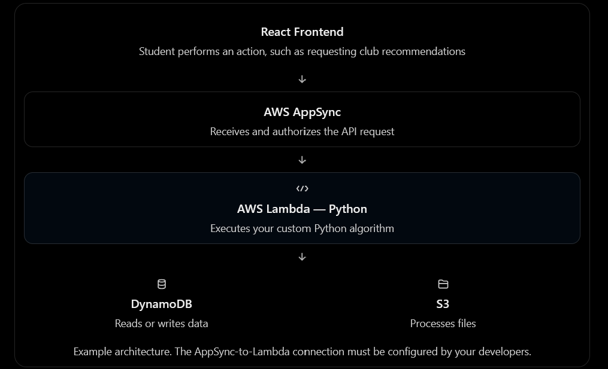

# Amazon Campus

One home for every club on campus: events, announcements, posts, and club info in a single web app built on AWS.

Built by the SIBC Amazon team as a proof of concept for Amazon, presented in mid-November 2026, with a Notre Dame pilot planned. **This is a shared development environment, not a production app.** Don't store confidential student or club financial information in it.

**Live app:** https://main.d1hufekmax824i.amplifyapp.com

## The problem

Notre Dame has about 500 recognized clubs, which hosted 8,855 events in 2024–25. Their news is split across GroupMe, Slack, Discord, and Instagram, so a student in four clubs checks four apps to find out what's happening this week. Amazon Campus puts it all in one place.

## Features

**Working** (real data, saved in AWS)
- **Accounts:** email sign-up and sign-in, then a first-time profile (name, major, class year, interests) you can edit later
- **Home:** your upcoming schedule and your clubs, each with its next event and latest announcement
- **Clubs:** a directory with search (also from the top bar) and category filters; club pages with description, member count, founding year, upcoming events, and announcements; join and leave
- **Events:** RSVP with "going" counts; a calendar of your RSVPs where you can cancel (with undo); one-tap export to Google, Apple, or Outlook
- **Inbox:** announcements and events from your clubs, newest first
- **Notifications:** an in-app list with a live unread badge, optional browser alerts, and email alerts plus a weekly digest once an Amazon SES sender is set up
- **Discover:** a feed of club posts (up to four photos each) mixed with upcoming events, with "For you" and "My clubs" tabs, likes, and edit/delete
- **Club roles:** admins run the platform; club leaders choose which members can post; officers get a "Manage club" section to post to Discover and post announcements
- **Admin tools:** load demo content, assign club leaders, and look up user IDs

**Sample data only** (shown in the app, not saved yet)
- Club finance ledger (balance, money in and out, transactions) in the officer view

**Not finished yet** (planned for the MVP)
- "Post event" for club leaders, and announcements by leaders who aren't admins: event and announcement writes are admin-only until a backend rule or Lambda allows leaders
- Limiting sign-up to @nd.edu email addresses
- The Discover ranking (interests, clubs, timing, RSVPs); the feed is newest first for now
- Loading the Discover feed a page at a time

**Concept previews** (future expansion, marked "Concept" in the app)
- Group chats and direct messages
- Paying club dues online
- Club videos (meeting recordings and highlights)
- Club documents and file sharing
- Teams within a club, each with its own lead and members
- Two-way Google Calendar sync

**Further ideas** (not in the app): AI-generated event descriptions and tags, club analytics, stronger protection for financial and personal data, backups and data export, and expanding beyond Notre Dame to other schools and organizations.

## How it's built

| Layer | Technology |
| --- | --- |
| Frontend | React, TypeScript, Vite, Tailwind CSS (mobile-first web app) |
| Hosting and deployment | AWS Amplify Gen 2; every push to `main` deploys the backend and the site |
| Sign-in | Amazon Cognito |
| API and data | AWS AppSync and Amazon DynamoDB |
| Files | Amazon S3 (post images, profile pictures, club files) |
| Backend logic | Python AWS Lambda functions: Discover posts and likes, member and RSVP counts, notifications |
| Scheduled jobs and email | Amazon EventBridge and Amazon SES |

All AWS resources are in `us-east-2` (Ohio) and are defined in code under `amplify/`.



## Repository layout

```text
Code/
├── amplify/              # Backend: sign-in, data models, storage, Lambda functions
│   ├── auth/             # Cognito settings
│   ├── data/             # Data models and access rules (AppSync + DynamoDB)
│   ├── storage/          # S3 folders and access rules
│   ├── functions/        # Python Lambdas: discover, stats, notifications, python-template
│   └── backend.ts        # Registers every backend resource
├── frontend/             # React web app (see frontend/README.md)
├── docs/                 # Feature docs and the architecture diagram
├── amplify.yml           # Build and deploy steps Amplify runs on each push
├── AWS_SETUP.md          # AWS setup, services, and developer handoff
└── INSTRUCTIONS.md       # GitHub SSH setup and branch workflow
```

## Getting started

1. Install Node.js 22 or newer, Git, and VS Code.
2. Set up GitHub SSH and clone the repository: see [INSTRUCTIONS.md](INSTRUCTIONS.md).
3. Install dependencies from the repository root:

   ```bash
   npm ci
   npm --prefix frontend ci
   ```

4. Get `frontend/amplify_outputs.json`, which connects the app to the backend: see step 4 of [AWS_SETUP.md](AWS_SETUP.md#1-quick-start-application-developers). It's generated per environment and never committed.
5. Start the app and open the link it prints:

   ```bash
   npm --prefix frontend run dev
   ```

6. To fill an empty database with demo clubs, events, announcements, and posts, an admin opens **Settings → Admin tools → Demo data**.

## Documentation

| Document | What it covers |
| --- | --- |
| [INSTRUCTIONS.md](INSTRUCTIONS.md) | GitHub SSH setup, cloning, weekly branches, pull requests |
| [AWS_SETUP.md](AWS_SETUP.md) | AWS services, setup, deployment, troubleshooting |
| [frontend/README.md](frontend/README.md) | Frontend structure, styling, loading data, demo content |
| [frontend/src/lib/session/README.md](frontend/src/lib/session/README.md) | Signed-in user, clubs, and roles shared across pages |
| [docs/NOTIFICATIONS.md](docs/NOTIFICATIONS.md) | Notifications, email setup, and browser alerts |

## License

Apache 2.0. See [LICENSE](LICENSE).
